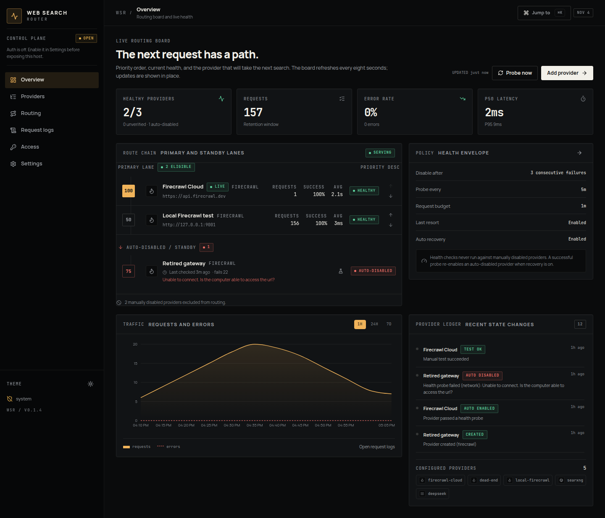

<div align="center">

<h1>Web Search Router</h1>

<strong>One endpoint for every search provider. Priority first. Failover by default.</strong>

<p>
  A self-hosted gateway for Firecrawl, DeepSeek, OpenCode Web Search, and a broad library of search APIs.
  It routes to the highest-priority healthy provider, disables broken upstreams,
  probes them on a schedule, and brings them back automatically.
</p>

<p>
  <a href="https://github.com/zbejas/web-search-router/pkgs/container/web-search-router">Docker Image</a>
  ·
  <a href="#quick-start">Quick Start</a>
  ·
  <a href="docs/README.md">Documentation</a>
</p>

<p>
  <a href="https://github.com/zbejas/web-search-router/actions/workflows/ci.yml"></a>
  <a href="https://github.com/zbejas/web-search-router/pkgs/container/web-search-router"></a>
  <a href="https://github.com/zbejas/web-search-router/blob/main/package.json"></a>
  <a href="https://github.com/zbejas/web-search-router/blob/main/LICENSE"></a>
  <a href="https://github.com/zbejas/web-search-router/commits/main"></a>
</p>

<p>Early, self-hosted, and built for operators</p>

</div>

---

<p align="center">
  
</p>

## Why Web Search Router

Search APIs fail differently: rate limits, exhausted credits, revoked keys, or a
single upstream going down. Wiring every client to every provider means every app
needs its own retry logic and a way to explain what happened.

Web Search Router puts one stable endpoint in front of all of them:

- **Priority routing.** Higher `priority` wins. Capability filtering keeps scrape
  requests away from search-only providers.
- **Automatic failover.** Provider-caused failures move to the next eligible
  provider. Client `4xx` errors pass through without disabling anyone.
- **Self-healing health.** After `failureThreshold` consecutive failures a provider
  is auto-disabled. Probes run every `healthCheckIntervalSeconds`; a successful probe
  re-enables it. A probe that reads an exhausted Firecrawl credit balance disables the
  provider immediately instead of waiting for the threshold. Manual disable is always
  respected.
- **Last-resort routing.** If every healthy provider fails, auto-disabled providers
  can be retried once before the router returns an error.
- **Firecrawl-compatible surface.** `/v1/*` and `/v2/*` preserve native shapes.
  Non-Firecrawl search results are normalized into the same v1/v2 envelopes.
- **Unified search.** `POST /api/search` returns the v2-shaped envelope regardless
  of provider.
- **Encrypted secrets.** Provider keys are AES-GCM encrypted at rest with a local
  `master.key`; request logs redact credentials.
- **One control plane.** Providers, priority, policy, auth, rate limits, retention,
  users, and API keys are all editable in the dashboard. No `.env`.

## Highlights

| | |
|---|---|
| **Route board** | See the primary lane, standby lane, priority, health, request count, success rate, and latency at a glance. Reorder without leaving the board. |
| **Health state machine** | `unknown` → `healthy` / `unhealthy`, with configurable failure thresholds, scheduled probes, automatic recovery, and manual tests. |
| **Firecrawl passthrough** | Search, scrape, crawl, map, extract, batch scrape, and unknown `/v1`/`/v2` paths pass through with the upstream status and body intact. |
| **Provider presets** | Firecrawl, DeepSeek, OpenCode Web Search, Tavily, Brave, SearXNG, Exa, Serper, DuckDuckGo, Google CSE, SerpAPI, SearchApi, ScrapingDog, ValueSERP, Zenserp, Kagi, You.com, NewsAPI, GNews, Hacker News, GitHub, Stack Exchange, Reddit, Crossref, Semantic Scholar, and Google Books. |
| **Operator-first UI** | Dark and light themes, keyboard navigation, real error states, mobile layout, and a command palette. |
| **Safe defaults** | Authentication is off on first run. Enabling it requires an admin account; proxy traffic then requires a router API key. |

## Quick Start

Run the published image:

```bash
docker run -d \
  --name web-search-router \
  -p 8123:8123 \
  -v web-search-router-data:/app/data \
  --restart unless-stopped \
  ghcr.io/zbejas/web-search-router:latest
```

Open [http://localhost:8123](http://localhost:8123), add a provider, and send a test
search. Authentication is disabled on first run; enable it in **Settings** before
exposing the host.

Or build and run the compose file from source:

```bash
git clone https://github.com/zbejas/web-search-router.git
cd web-search-router
docker compose up -d --build
```

Local Bun workflow:

```bash
bun install
bun run build
bun run start -- --port 8123 --host 0.0.0.0
```

The dashboard is served from `dist/`. For development, run `bun run dev` and
`bun run build:watch` in a second terminal.

## First Search

```bash
curl -X POST http://localhost:8123/v2/search \
  -H 'content-type: application/json' \
  -d '{"query":"web search routing","limit":5}'
```

Router headers identify where the request went:

```text
x-router-provider: firecrawl-cloud
x-router-provider-type: firecrawl
x-router-attempts: 1
x-router-latency-ms: 2144
x-router-request-id: ...
```

When authentication is enabled, send a router key:

```bash
curl -X POST http://localhost:8123/v2/search \
  -H 'authorization: Bearer wsr_...' \
  -H 'content-type: application/json' \
  -d '{"query":"web search routing","limit":5}'
```

## Providers

| Type | Target | Capabilities |
|---|---|---|
| `firecrawl` | Firecrawl Cloud or self-hosted | search, scrape, crawl, map, extract, batch scrape, passthrough |
| `deepseek` | `https://api.deepseek.com` | search |
| `opencode` | `https://opencode.ai` | search |
| `generic` | Any JSON search API | search, with broad presets and custom result mapping |

The generic adapter covers web search, news, research, and developer APIs. Presets
are starting points: each one is editable JSON, and provider-specific limits,
billing, and response shapes are documented in [docs/providers.md](docs/providers.md).

OpenCode providers also show workspace spend from the Console usage summary; the
credit balance appears when the key has Billing read permission.

Firecrawl keys and provider secrets are entered in the dashboard and encrypted with
`data/master.key`. Back up the entire data directory; without `master.key`, saved
keys cannot be decrypted.

## Configuration

All application configuration lives in SQLite and is edited in the web UI. The only
CLI options are:

```text
--port 8123          listening port
--host 0.0.0.0       listening host
--data-dir ./data    runtime data directory
```

There is no `.env` file. The compose file uses the named volume
`web-search-router-data` mounted at `/app/data`.

## Development

```bash
bun install
bun run dev              # backend watch mode
bun run build            # dashboard -> dist/
bun run typecheck        # tsc --noEmit
bun test tests/unit tests/integration
bun run test:e2e         # Playwright + Chrome
bun run test:all         # unit + integration + E2E
```

The test suite uses isolated temporary data directories and a local mock upstream.
E2E starts its own server on `127.0.0.1:4310` with a mock provider on
`127.0.0.1:4311`. See [docs/testing.md](docs/testing.md).

The version lives only in `package.json`; nothing else hardcodes it. CI runs on
every push and pull request. Bumping `version` in `package.json` on `main` tags
the commit `v<version>`, publishes `ghcr.io/zbejas/web-search-router:<version>`
plus `:latest`, and creates the GitHub release. Re-runs are idempotent: an
already published image, tag, or release is left alone. The workflow lives in
[`.github/workflows/docker-publish.yml`](.github/workflows/docker-publish.yml).

## Documentation

| Doc | Covers |
|---|---|
| [docs/product.md](docs/product.md) | Users, purpose, constraints, product principles |
| [docs/design.md](docs/design.md) | Visual system, components, responsive rules |
| [docs/architecture.md](docs/architecture.md) | Runtime, routing engine, health state machine, persistence |
| [docs/providers.md](docs/providers.md) | Provider types, config, probes, adding adapters |
| [docs/api.md](docs/api.md) | Proxy, search, management API, auth, errors |
| [docs/ui.md](docs/ui.md) | Dashboard structure and data flow |
| [docs/testing.md](docs/testing.md) | Test layers, isolation, live smoke tests |
| [docs/migration.md](docs/migration.md) | Upgrading from `firecrawl_router` |
| [AGENTS.md](AGENTS.md) | Task routing for coding agents |

## Project Layout

```text
src/index.tsx          CLI entry and server startup
src/app.ts             Runtime construction and HTTP routes
src/router.ts          Priority routing, failover, attempt logging
src/health.ts          Probe scheduler and recovery state
src/providers/         Adapter registry and provider implementations
src/client/            React dashboard
tests/                 Unit, integration, E2E, and helpers
docs/                  Engineering documentation
```

## License

Licensed under the [GNU Affero General Public License v3.0](LICENSE).
